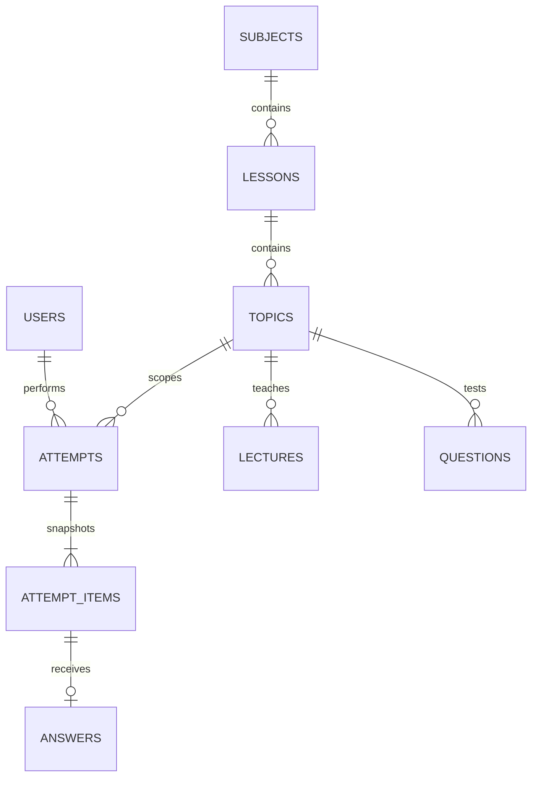

# Thiết kế và đối chiếu yêu cầu

## Luồng MVC

Browser → AppFilter → Controller Servlet → Service → DAO → SQL Server. Controller đưa model/Map vào request → JSP dưới WEB-INF. Chat trả JSON, không trả HTML từ AI. `Sql` là helper JDBC, không là ORM.

## Quan hệ dữ liệu

Khóa users.created_by được dùng cho nội dung, để biết người tạo. `app_settings` lưu prompt theo key. Khóa ngoại không cascade-delete lịch sử. Xóa mềm làm mất nội dung khỏi danh mục chọn nhưng vẫn giữ bản chụp và liên kết bài làm cũ.

## Routes và quyền

| Route | Quyền | Nhiệm vụ |
|---|---|---|
| /login, /register | Khách | Đăng nhập, đăng ký student |
| /logout | Đã đăng nhập, POST+CSRF | Hủy session |
| /admin/dashboard | ADMIN | Thống kê |
| /admin/users | ADMIN | CRUD, tìm kiếm, phân trang, khóa |
| /admin/settings | ADMIN | System prompt |
| /teacher/catalog | TEACHER, ADMIN | CRUD theo entity allowlist |
| /teacher/generate | TEACHER, ADMIN | Sinh, sửa, duyệt bản nháp |
| /teacher/students, /teacher/results | TEACHER, ADMIN | Học sinh/kết quả |
| /student/learn, /student/topic | STUDENT | Bài học và chủ đề |
| /student/start | STUDENT, POST+CSRF | Tạo lượt luyện tập |
| /student/practice | STUDENT + ownership | Hiển thị/nộp câu hiện tại |
| /student/review, /student/history | STUDENT + ownership | Xem lại |
| /student/tutor, /api/chat | STUDENT | Chat từng bước |
| /results, /review, /upload | Chủ bài hoặc TEACHER/ADMIN | Chi tiết/ảnh bài làm |

## Nộp bài và lỗi

Trắc nghiệm: tải snapshot → kiểm tra position/option → tính điểm server → transaction tăng position và insert answer → redirect trang review → câu sai gọi chat. Khi gọi AI thất bại, bài trắc nghiệm đã nộp vẫn được giữ và nút gửi chat có thể thử lại.

Tự luận: kiểm tra ảnh → Gemini vision JSON → kiểm tra readable/score/độ dài → lưu file UUID → transaction lưu answer → review. Nếu transaction thất bại thì xóa file vừa tạo; nếu AI lỗi thì chưa lưu ảnh/điểm, học sinh chọn lại ảnh để thử. Sau khi server xác nhận thành công, tải lại trang không nộp trùng vì Post/Redirect/Get và unique constraint.

Sinh câu hỏi: JSON kiểm tra số lượng, loại, nội dung, đáp án, độ khó → session draft → POST approve có CSRF và token riêng → validate lại → một transaction lưu tất cả câu đã chọn. Không trộn câu hỏi chưa duyệt vào lượt học sinh.

## Ranh giới kiểm thử

Có thể kiểm thử HttpClient với HTTP stub cục bộ qua `ai.baseUrl` trong file config kiểm thử. Thuộc tính này dành cho kiểm thử/proxy quản trị, không có ô nhập trên giao diện. Production mặc định gọi HTTPS chính thức của Google. Các test dùng stub không xác nhận chất lượng chấm hoặc giảng dạy của model thật.

Build dự án Ant không phụ thuộc đường dẫn máy tác giả. `nbproject/build-impl.xml` và `ant-deploy.xml` được sinh/lấy từ NetBeans 17; `build.xml` ghi đè các target build/test độc lập. F6 vẫn sử dụng tác vụ deploy của NetBeans với server người dùng chọn.
